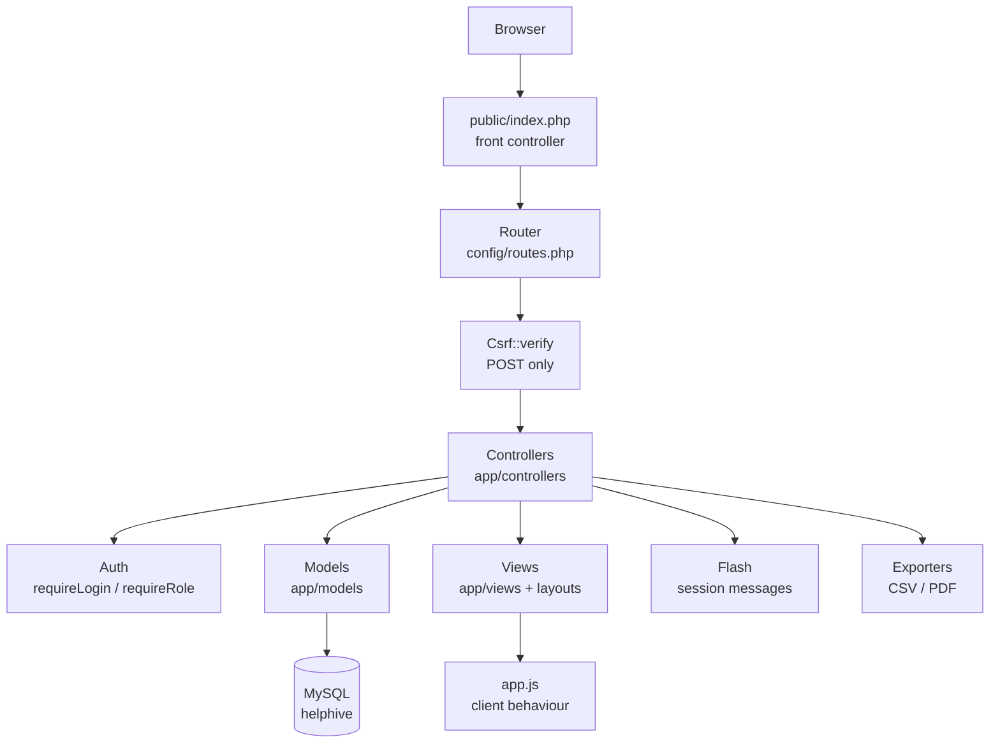
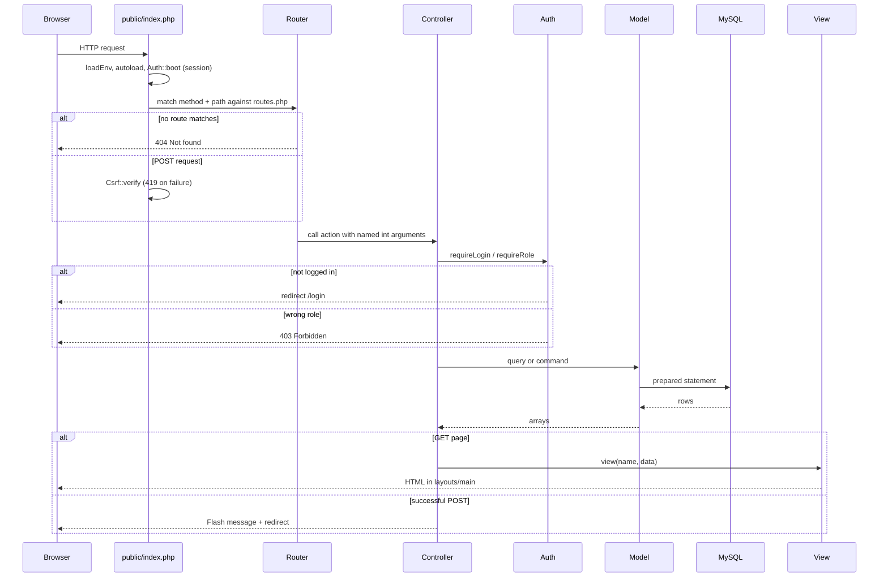

# HelpHive - Architecture

Status snapshot: codebase as of 2026-11-13 (Sprint 3). This document describes what the code does today. Where the implementation differs from the intended design, the difference is recorded in `docs/KNOWN_GAPS.md`.

## 1. Purpose and scope

HelpHive is a community volunteering web platform. Volunteers browse, register for, and track service opportunities. Organizations publish opportunities, mark attendance, and verify service hours. Administrators approve organizations and manage accounts.

Out of scope: native mobile apps, payment gateways, GPS or Maps APIs (location filtering is text based), and paid third-party SaaS.

Timeline: four Agile Scrum sprints ending December 12, 2026.

## 2. Technology and environment

| Item | Value |
|---|---|
| Language | PHP 8.1+ (vanilla, lightweight MVC, `declare(strict_types=1)`) |
| Database | MySQL 8, InnoDB, utf8mb4, accessed only through PDO |
| Frontend | PHP view templates, one stylesheet (`public/assets/css/style.css`), one script (`public/assets/js/app.js`) |
| PDF export | Dompdf (Composer, `vendor/`) |
| Local environment | Laragon, project folder `C:\Github\HelpHive` |
| Design source | Approved Figma prototype `HelpHive--Copy-`, node `308-39720` |

Document root: `public/`. A root-level `.htaccess` also rewrites every request into `public/`, so the project still works if Apache serves the project root. Serving `public/` directly is preferred, because it keeps `.env`, `app/`, `config/`, and `database/` outside the web root.

## 3. Layers

| Layer | Location | Responsibility |
|---|---|---|
| Entry point | `public/index.php` | Load `.env`, register autoloader, start session, match route, verify CSRF on POST, dispatch |
| Configuration | `config/env.php`, `config/database.php`, `config/routes.php` | Environment values, DB settings, route table |
| Controllers | `app/controllers/` | HTTP handling, role and ownership checks, input validation, choose view or redirect |
| Models | `app/models/` | All SQL, PDO prepared statements, transactions |
| Views | `app/views/` | PHP templates wrapped by `layouts/main.php`; output escaped with `e()` |
| Utilities | `app/utils/` | `Database`, `Auth`, `Csrf`, `Flash`, `helpers.php`, exporters |
| Client script | `public/assets/js/app.js` | Modals, dropdowns, client-side search filtering, bookmark state, toasts |



## 4. Request lifecycle



Router details (`public/index.php`):

- Dynamic segments are written `{id}` and compiled to `(?P<id>\d+)`, so only numeric ids match.
- Captured values are passed to the controller action as named integer arguments, so every action that takes a URL parameter must declare `int $id`.
- Controllers are instantiated with `new $class()` and have no constructor dependencies; each action builds its own models through `Database::connection()`.

## 5. Roles and access

| Role | Value in `users.role` | Landing page after login |
|---|---|---|
| Volunteer | `volunteer` | `/volunteer/dashboard` |
| Organization | `organization` | `/org/dashboard` |
| Administrator | `admin` | `/admin/dashboard` |
| Guest | no session | public pages only |

Session shape written by `Auth::login()`: `$_SESSION['user'] = ['id', 'name', 'role']`. The header layout reads `$currentUser['name']` and `$currentUser['role']`.

Enforcement order inside each protected action:

1. `Auth::requireLogin()` or `Auth::requireRole(...)`: redirect to `/login` for guests, 403 for the wrong role.
2. Ownership check: the organization id is derived from the session user (`OrganizationModel::idForUser`) and then used in the SQL `WHERE` clause (`organization_id = :oid`) or compared to the record before it is shown.
3. State check inside the model (capacity, deadline, attendance state, verification state).

The role is stored in the session. If an administrator changes a user's role or deactivates a user, an already open session keeps working until it ends (see `docs/KNOWN_GAPS.md`).

## 6. Business invariants and where they are enforced

| Rule | Database | Model | Controller |
|---|---|---|---|
| Unverified hours never count as verified | `chk_ah_verified` CHECK | Every total and report query filters `verification_status = 'verified'` | Views show verified and pending totals as separate figures |
| Hours can be verified only after Present | none | `HourModel::verify` requires `attendance_status = 'present'` | Flash error explains the rule |
| Organizations touch only their own data | FKs | `WHERE o.organization_id = :oid` in `HourModel` and `OpportunityModel` | Ownership comparison in `edit`, `index` (attendance) |
| No duplicate registration | `UNIQUE(opportunity_id, volunteer_id)` | `RegistrationModel::register` maps SQLSTATE 23000 to `duplicate` | Flash info and redirect |
| Capacity limit | none | Transaction, `SELECT ... FOR UPDATE` on the opportunity row, count of `registered` rows | Flash error when full |
| Registration deadline | `chk_opp_dates` (deadline <= start) | Compares `NOW` to `registration_deadline` | Flash error |
| Only published opportunities accept registration | none | `status = 'published'` check | Flash error |
| Valid event dates | `chk_opp_dates`, `chk_opp_capacity` | none | none (see gaps) |
| Admin approval of organizations | `organizations.is_approved` | `OrganizationModel::approve` / `reject` | `AdminController` |

## 7. Security controls

| Control | Status | Where |
|---|---|---|
| Prepared statements, `ERRMODE_EXCEPTION`, `EMULATE_PREPARES=false` | Implemented | `app/utils/Database.php`, all models |
| Output escaping with `e()` | Implemented | Views |
| CSRF token on POST | Implemented | `Csrf::verify` in front controller, `Csrf::field()` in forms |
| Password hashing | Implemented | `password_hash` / `password_verify` in `AuthController` |
| Session id regeneration on login | Implemented | `Auth::login` |
| HttpOnly and SameSite cookies | Implemented | `Auth::boot` |
| Role checks on every protected action | Implemented | Controllers |
| CSV formula-injection guard | Implemented | `CsvExporter` |
| Login rate limiting | Not implemented | see gaps |
| Email format validation, password strength beyond length 8 | Not implemented | see gaps |

## 8. Frontend architecture

- `layouts/main.php` composes `header.php`, the page content, `footer.php`, and `modals.php` (login and sign-up modals, role dropdown).
- Views receive data only through `view('path', $data)`; `render()` includes partials without a layout.
- `app.js` owns client behaviour: modal handling, the role selector, location and distance dropdowns, filter chips, the "Reset All Filters" control, URL query sync, toast messages, and bookmark state.
- Search is a hybrid of server and client filtering; see `docs/FLOW_SEARCH.md`.
- Bookmarks ("Saved") are persisted in the `saved_opportunities` database table and synced with client state.

## 9. Repository layout (current)

```
HelpHive/
|-- .env  .env.example  .gitignore  .htaccess
|-- README.md  ARCHITECTURE.md  DATABASE_SCHEMA.md  API_ROUTING.md  CHANGELOG.md
|-- docs/
|   |-- ERD.md
|   |-- FLOW_AUTH.md
|   |-- FLOW_VALIDATION.md
|   |-- FLOW_SEARCH.md
|   |-- FLOW_REGISTRATION_AND_HOURS.md
|   |-- FLOW_ORGANIZATION_AND_ADMIN.md
|   `-- KNOWN_GAPS.md
|-- config/        env.php  database.php  routes.php
|-- database/      schema.sql  seed.sql
|-- public/        index.php  .htaccess  assets/ (css, js, icons, images)
`-- app/
    |-- controllers/  Home, Auth, Opportunity, Registration, Volunteer,
    |                 OrgDashboard, OrgProfile, OrgOpportunity, Attendance,
    |                 Report, Notification, Admin
    |-- models/       User, Organization, Opportunity, Registration, Hour, Notification, SavedOpportunity
    |-- utils/        Database, Auth, Csrf, Flash, helpers.php, exporters/ (Csv, Pdf)
    `-- views/        layouts, home, auth, opportunities, volunteer, org, admin, notifications
```

## 10. Document map

| File | Answers |
|---|---|
| `README.md` | How to install and run |
| `ARCHITECTURE.md` | How the system is structured and why |
| `DATABASE_SCHEMA.md` | Table definitions, constraints, indexes |
| `docs/ERD.md` | Entity relationship diagram and state machines |
| `API_ROUTING.md` | Every route, controller action, and access level |
| `docs/FLOW_AUTH.md` | Registration, organization registration, login, logout, session handling |
| `docs/FLOW_VALIDATION.md` | Input validation and access decision rules |
| `docs/FLOW_SEARCH.md` | Search and filter behavior |
| `docs/FLOW_REGISTRATION_AND_HOURS.md` | Volunteer registration, attendance, hour verification, reports |
| `docs/FLOW_ORGANIZATION_AND_ADMIN.md` | Organization onboarding, opportunity lifecycle, admin actions |
| `docs/KNOWN_GAPS.md` | Differences between intended behavior and current code |
| `CHANGELOG.md` | History of changes |