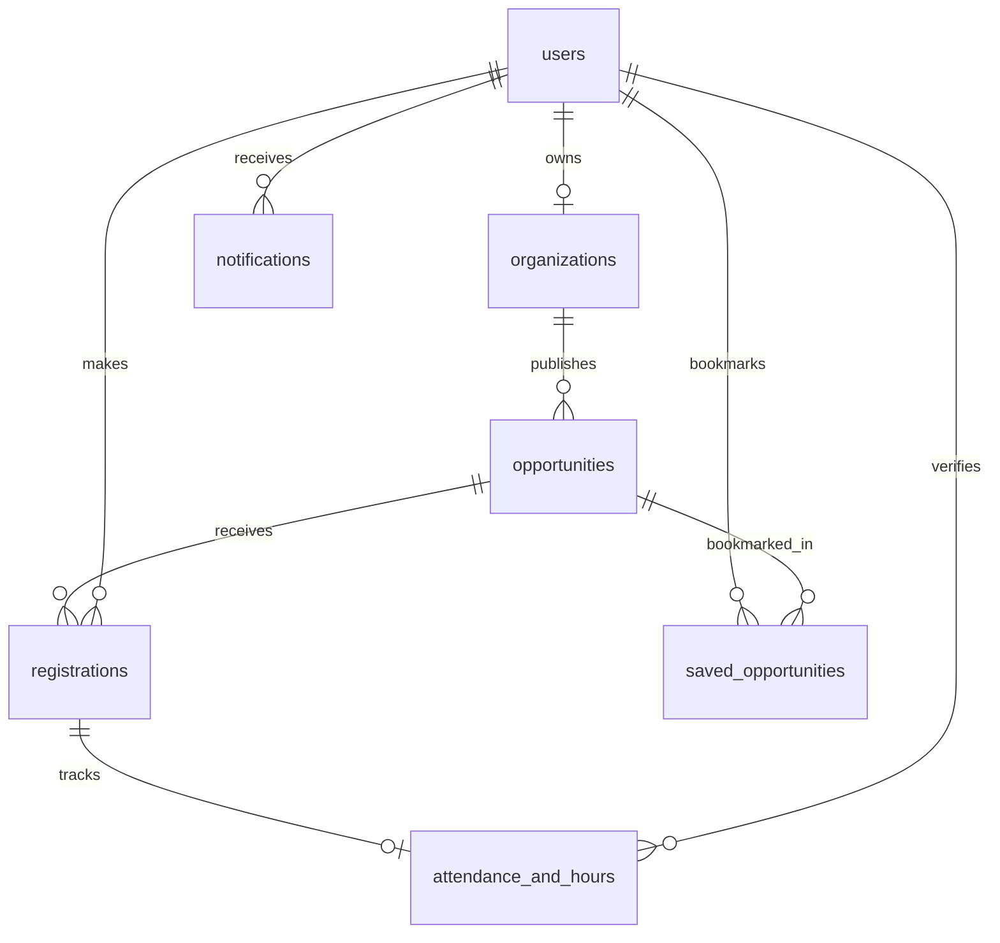

# HelpHive — Database Schema & Architecture

## Overview
HelpHive uses MySQL 8 (InnoDB engine) with `utf8mb4` character set and `utf8mb4_unicode_ci` collation.
All queries interact via PHP PDO using prepared statements with `PDO::ATTR_EMULATE_PREPARES => false`.

---

## Entity Relationship Diagram

The full diagram with attributes, state machines, and read/write map is in `docs/ERD.md`. Relationship overview:



---

## Tables

### 1. `users`
Core user identity for all platform roles: Volunteers, Organizations, Administrators.

| Column | Type | Attributes | Description |
|---|---|---|---|
| `id` | INT UNSIGNED | PK, AUTO_INCREMENT | Unique user identifier |
| `full_name` | VARCHAR(120) | NOT NULL | User's full name |
| `email` | VARCHAR(190) | NOT NULL, UNIQUE | Login email address |
| `password_hash` | VARCHAR(255) | NOT NULL | Bcrypt hash (`PASSWORD_DEFAULT`) |
| `role` | ENUM | NOT NULL, DEFAULT 'volunteer' | `'volunteer'`, `'organization'`, `'admin'` |
| `is_active` | TINYINT(1) | NOT NULL, DEFAULT 1 | 1 = active, 0 = disabled |
| `created_at` | TIMESTAMP | DEFAULT CURRENT_TIMESTAMP | Account creation time |
| `updated_at` | TIMESTAMP | ON UPDATE CURRENT_TIMESTAMP | Last profile update |

---

### 2. `organizations`
Profiles for verified nonprofits and community organizer bodies.

| Column | Type | Attributes | Description |
|---|---|---|---|
| `id` | INT UNSIGNED | PK, AUTO_INCREMENT | Organization identifier |
| `user_id` | INT UNSIGNED | NOT NULL, UNIQUE, FK (`users.id`) | Owning user account |
| `name` | VARCHAR(160) | NOT NULL | Organization public display name |
| `description` | TEXT | NULL | Mission statement and overview |
| `contact_email` | VARCHAR(190) | NULL | Official contact email |
| `location` | VARCHAR(160) | NULL | City / Province headquarters |
| `is_approved` | TINYINT(1) | NOT NULL, DEFAULT 0 | 1 = approved by platform admin |
| `created_at` | TIMESTAMP | DEFAULT CURRENT_TIMESTAMP | Registration date |

---

### 3. `opportunities`
Volunteering events published by approved organizations.

| Column | Type | Attributes | Description |
|---|---|---|---|
| `id` | INT UNSIGNED | PK, AUTO_INCREMENT | Opportunity identifier |
| `organization_id` | INT UNSIGNED | NOT NULL, FK (`organizations.id`) | Owning organization |
| `title` | VARCHAR(180) | NOT NULL | Event title |
| `description` | TEXT | NOT NULL | Event mission, duties, and context |
| `cause_area` | VARCHAR(80) | NOT NULL | e.g. 'Environment', 'Education', 'Animal Welfare' |
| `location` | VARCHAR(160) | NOT NULL | Specific venue or city address |
| `start_at` | DATETIME | NOT NULL | Activity start timestamp |
| `end_at` | DATETIME | NOT NULL | Activity end timestamp |
| `registration_deadline`| DATETIME | NOT NULL | Cutoff time for volunteer signups |
| `capacity` | SMALLINT UNSIGNED | NOT NULL, CHECK (`capacity > 0`) | Max volunteers allowed |
| `requirements` | TEXT | NULL | Dress code, required tools, age guidelines |
| `status` | ENUM | DEFAULT 'draft' | `'draft'`, `'published'`, `'cancelled'`, `'completed'` |
| `created_at` | TIMESTAMP | DEFAULT CURRENT_TIMESTAMP | Created timestamp |
| `updated_at` | TIMESTAMP | ON UPDATE CURRENT_TIMESTAMP | Modified timestamp |

**Constraints:**
- `chk_opp_dates`: `CHECK (end_at > start_at AND registration_deadline <= start_at)`
- Full-text index on `(title, description)`

---

### 4. `registrations`
Volunteer sign-up records with anti-overbooking transaction locking.

| Column | Type | Attributes | Description |
|---|---|---|---|
| `id` | INT UNSIGNED | PK, AUTO_INCREMENT | Registration identifier |
| `opportunity_id` | INT UNSIGNED | NOT NULL, FK (`opportunities.id`) | Associated event |
| `volunteer_id` | INT UNSIGNED | NOT NULL, FK (`users.id`) | Registered volunteer |
| `status` | ENUM | DEFAULT 'registered' | `'registered'`, `'cancelled'`, `'waitlisted'` |
| `registered_at` | TIMESTAMP | DEFAULT CURRENT_TIMESTAMP | Registration timestamp |

**Constraints:**
- `uq_reg_unique`: `UNIQUE(opportunity_id, volunteer_id)` — strictly prevents double-registration.

---

### 5. `attendance_and_hours`
Official hour verification tracking.

| Column | Type | Attributes | Description |
|---|---|---|---|
| `id` | INT UNSIGNED | PK, AUTO_INCREMENT | Record identifier |
| `registration_id` | INT UNSIGNED | NOT NULL, UNIQUE, FK (`registrations.id`)| Associated registration |
| `attendance_status` | ENUM | DEFAULT 'pending' | `'pending'`, `'present'`, `'absent'`, `'excused'` |
| `hours_claimed` | DECIMAL(5,2) | NOT NULL, DEFAULT 0.00 | Hours claimed by volunteer |
| `hours_verified` | DECIMAL(5,2) | NULL | Officially verified hours |
| `verification_status`| ENUM | DEFAULT 'unverified' | `'unverified'`, `'pending'`, `'verified'`, `'rejected'` |
| `verified_by` | INT UNSIGNED | NULL, FK (`users.id`) | Verifying coordinator user ID |
| `verified_at` | DATETIME | NULL | Timestamp of verification |
| `updated_at` | TIMESTAMP | ON UPDATE CURRENT_TIMESTAMP | Last status update |

**Integrity Invariants:**
- `chk_ah_verified`:
  ```sql
  CHECK (
    (verification_status = 'verified' AND hours_verified IS NOT NULL AND verified_at IS NOT NULL)
    OR (verification_status <> 'verified' AND hours_verified IS NULL)
  )
  ```
- Unverified hours **never** merge into verified totals or participation reports.

---

### 6. `notifications`
In-app alert delivery.

| Column | Type | Attributes | Description |
|---|---|---|---|
| `id` | INT UNSIGNED | PK, AUTO_INCREMENT | Notification ID |
| `user_id` | INT UNSIGNED | NOT NULL, FK (`users.id`) | Target user |
| `type` | VARCHAR(40) | NOT NULL | Alert category |
| `message` | VARCHAR(255) | NOT NULL | Human-readable alert text |
| `link` | VARCHAR(255) | NULL | Destination URL |
| `is_read` | TINYINT(1) | NOT NULL, DEFAULT 0 | 0 = unread, 1 = read |
| `created_at` | TIMESTAMP | DEFAULT CURRENT_TIMESTAMP | Delivery timestamp |

---

### 7. `saved_opportunities`
Bookmarked volunteer opportunities.

| Column | Type | Attributes | Description |
|---|---|---|---|
| `user_id` | INT UNSIGNED | NOT NULL, PK, FK (`users.id`) | Owning user |
| `opportunity_id` | INT UNSIGNED | NOT NULL, PK, FK (`opportunities.id`) | Saved event |
| `created_at` | TIMESTAMP | DEFAULT CURRENT_TIMESTAMP | Bookmark timestamp |

**Constraints:**
- Composite Primary Key: `(user_id, opportunity_id)`

---

## Indexing strategy

| Table | Index | Purpose |
|---|---|---|
| users | `UNIQUE(email)` | Login lookup, duplicate prevention |
| users | `idx_users_role (role)` | Admin filtering by role |
| organizations | `UNIQUE(user_id)` | One organization per user, ownership lookup |
| opportunities | `idx_opp_status_start (status, start_at)` | Public listing ordered by date |
| opportunities | `idx_opp_cause (cause_area)` | Cause filter |
| opportunities | `idx_opp_location (location)` | Location filter (prefix searches only; `LIKE '%x%'` cannot use it) |
| opportunities | `FULLTEXT ft_opp_search (title, description)` | Reserved for keyword search (current query uses `LIKE`) |
| registrations | `UNIQUE(opportunity_id, volunteer_id)` | Duplicate prevention |
| registrations | `idx_reg_volunteer (volunteer_id)` | Volunteer dashboard |
| registrations | `idx_reg_opp_status (opportunity_id, status)` | Capacity count |
| attendance_and_hours | `UNIQUE(registration_id)` | One hours record per registration |
| attendance_and_hours | `idx_ah_status (verification_status)` | Verified and pending totals, reports |
| notifications | `idx_notif_user_read (user_id, is_read)` | Unread badge and list |
| saved_opportunities | `PRIMARY KEY (user_id, opportunity_id)` | Fast bookmark lookup, duplicate prevention |

## Query rules (hour integrity)

1. Any query that produces an official total or report row must include `verification_status = 'verified'` and read `hours_verified`.
2. Display-only pending totals read `hours_claimed` for `unverified` and `pending` rows and are shown separately.
3. All hour queries live in `app/models/HourModel.php`. New hour queries go there.
4. Organization-scoped queries join through `registrations` and `opportunities` and filter on `o.organization_id`.

## Transactions

| Operation | Method | Locking |
|---|---|---|
| Register for an opportunity | `RegistrationModel::register` | `SELECT ... FOR UPDATE` on the opportunity row, then capacity count, insert registration, insert hours record, commit |

## Seed data (`database/seed.sql`)

Loads one administrator, three organization accounts with approved organizations (Blue Shores Initiative, Green Shift Media, Paws & Care Foundation), two volunteers, sample opportunities, and sample registrations, attendance and hour records, and sample notifications matching the Figma scenarios. Re-run `schema.sql` before reloading the seed to avoid duplicate key errors.

## Planned schema changes (not in `schema.sql` yet)

| Change | Reason | Gap ID | Status |
|---|---|---|---|
| `saved_opportunities (user_id, opportunity_id, created_at)`, composite PK, FKs to `users` and `opportunities` | Persist bookmarks | G-17 | Implemented |
| `opportunities.location_type`, `duration`, `skills` (or removal of those filters) | Back the client-only search filters | G-14 | Planned |
| `organizations.organization_type`, `cause_area` | Currently packed into `description` as `[Type: ...] [Cause: ...]` | see `docs/FLOW_AUTH.md` | Planned |
| Optional `hour_audit_log` | Record who changed attendance or revoked verified hours | G-05, G-06 | Planned |