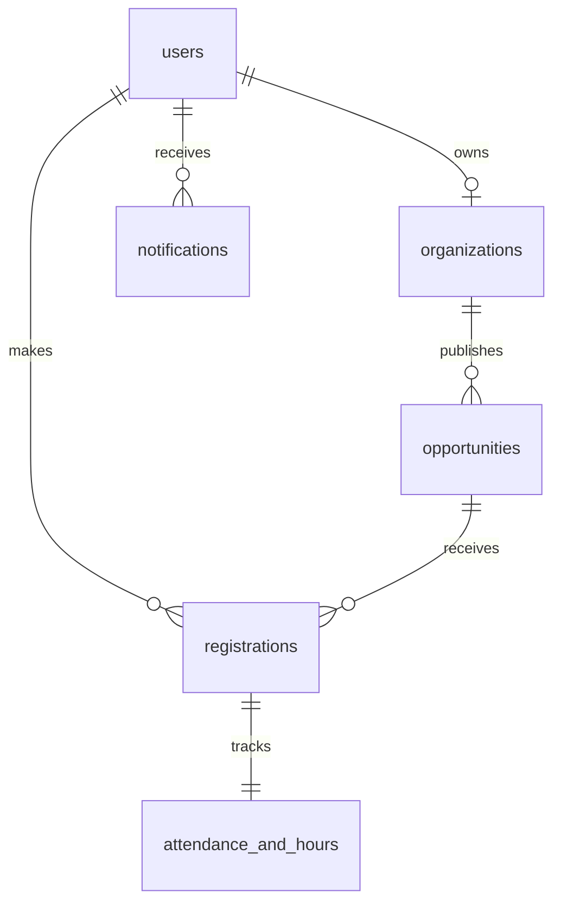

# HelpHive — Database Schema & Architecture

## Overview
HelpHive uses MySQL 8 (InnoDB engine) with `utf8mb4` character set and `utf8mb4_unicode_ci` collation.
All queries interact via PHP PDO using prepared statements with `PDO::ATTR_EMULATE_PREPARES => false`.

---

## Entity Relationship Diagram



---

## Tables

### 1. `users`
Core user identity for all platform roles: Volunteers, Organizations, Administrators.

| Column | Type | Attributes | Description |
|---|---|---|---|
| `id` | INT UNSIGNED | PK, AUTO_INCREMENT | Unique user identifier |
| `full_name` | VARCHAR(120) | NOT NULL | User's full name |
| `email` | VARCHAR(190) | NOT NULL, UNIQUE | Login email address |
| `password_hash` | VARCHAR(255) | NOT NULL | Bcrypt hash (`PASSWORD_DEFAULT`) |
| `role` | ENUM | NOT NULL, DEFAULT 'volunteer' | `'volunteer'`, `'organization'`, `'admin'` |
| `is_active` | TINYINT(1) | NOT NULL, DEFAULT 1 | 1 = active, 0 = disabled |
| `created_at` | TIMESTAMP | DEFAULT CURRENT_TIMESTAMP | Account creation time |
| `updated_at` | TIMESTAMP | ON UPDATE CURRENT_TIMESTAMP | Last profile update |

---

### 2. `organizations`
Profiles for verified nonprofits and community organizer bodies.

| Column | Type | Attributes | Description |
|---|---|---|---|
| `id` | INT UNSIGNED | PK, AUTO_INCREMENT | Organization identifier |
| `user_id` | INT UNSIGNED | NOT NULL, UNIQUE, FK (`users.id`) | Owning user account |
| `name` | VARCHAR(160) | NOT NULL | Organization public display name |
| `description` | TEXT | NULL | Mission statement and overview |
| `contact_email` | VARCHAR(190) | NULL | Official contact email |
| `location` | VARCHAR(160) | NULL | City / Province headquarters |
| `is_approved` | TINYINT(1) | NOT NULL, DEFAULT 0 | 1 = approved by platform admin |
| `created_at` | TIMESTAMP | DEFAULT CURRENT_TIMESTAMP | Registration date |

---

### 3. `opportunities`
Volunteering events published by approved organizations.

| Column | Type | Attributes | Description |
|---|---|---|---|
| `id` | INT UNSIGNED | PK, AUTO_INCREMENT | Opportunity identifier |
| `organization_id` | INT UNSIGNED | NOT NULL, FK (`organizations.id`) | Owning organization |
| `title` | VARCHAR(180) | NOT NULL | Event title |
| `description` | TEXT | NOT NULL | Event mission, duties, and context |
| `cause_area` | VARCHAR(80) | NOT NULL | e.g. 'Environment', 'Education', 'Animal Welfare' |
| `location` | VARCHAR(160) | NOT NULL | Specific venue or city address |
| `start_at` | DATETIME | NOT NULL | Activity start timestamp |
| `end_at` | DATETIME | NOT NULL | Activity end timestamp |
| `registration_deadline`| DATETIME | NOT NULL | Cutoff time for volunteer signups |
| `capacity` | SMALLINT UNSIGNED | NOT NULL, CHECK (`capacity > 0`) | Max volunteers allowed |
| `requirements` | TEXT | NULL | Dress code, required tools, age guidelines |
| `status` | ENUM | DEFAULT 'draft' | `'draft'`, `'published'`, `'cancelled'`, `'completed'` |
| `created_at` | TIMESTAMP | DEFAULT CURRENT_TIMESTAMP | Created timestamp |
| `updated_at` | TIMESTAMP | ON UPDATE CURRENT_TIMESTAMP | Modified timestamp |

**Constraints:**
- `chk_opp_dates`: `CHECK (end_at > start_at AND registration_deadline <= start_at)`
- Full-text index on `(title, description)`

---

### 4. `registrations`
Volunteer sign-up records with anti-overbooking transaction locking.

| Column | Type | Attributes | Description |
|---|---|---|---|
| `id` | INT UNSIGNED | PK, AUTO_INCREMENT | Registration identifier |
| `opportunity_id` | INT UNSIGNED | NOT NULL, FK (`opportunities.id`) | Associated event |
| `volunteer_id` | INT UNSIGNED | NOT NULL, FK (`users.id`) | Registered volunteer |
| `status` | ENUM | DEFAULT 'registered' | `'registered'`, `'cancelled'`, `'waitlisted'` |
| `registered_at` | TIMESTAMP | DEFAULT CURRENT_TIMESTAMP | Registration timestamp |

**Constraints:**
- `uq_reg_unique`: `UNIQUE(opportunity_id, volunteer_id)` — strictly prevents double-registration.

---

### 5. `attendance_and_hours`
Official hour verification tracking.

| Column | Type | Attributes | Description |
|---|---|---|---|
| `id` | INT UNSIGNED | PK, AUTO_INCREMENT | Record identifier |
| `registration_id` | INT UNSIGNED | NOT NULL, UNIQUE, FK (`registrations.id`)| Associated registration |
| `attendance_status` | ENUM | DEFAULT 'pending' | `'pending'`, `'present'`, `'absent'`, `'excused'` |
| `hours_claimed` | DECIMAL(5,2) | NOT NULL, DEFAULT 0.00 | Hours claimed by volunteer |
| `hours_verified` | DECIMAL(5,2) | NULL | Officially verified hours |
| `verification_status`| ENUM | DEFAULT 'unverified' | `'unverified'`, `'pending'`, `'verified'`, `'rejected'` |
| `verified_by` | INT UNSIGNED | NULL, FK (`users.id`) | Verifying coordinator user ID |
| `verified_at` | DATETIME | NULL | Timestamp of verification |
| `updated_at` | TIMESTAMP | ON UPDATE CURRENT_TIMESTAMP | Last status update |

**Integrity Invariants:**
- `chk_ah_verified`:
  ```sql
  CHECK (
    (verification_status = 'verified' AND hours_verified IS NOT NULL AND verified_at IS NOT NULL)
    OR (verification_status <> 'verified' AND hours_verified IS NULL)
  )
  ```
- Unverified hours **never** merge into verified totals or participation reports.

---

### 6. `notifications`
In-app alert delivery.

| Column | Type | Attributes | Description |
|---|---|---|---|
| `id` | INT UNSIGNED | PK, AUTO_INCREMENT | Notification ID |
| `user_id` | INT UNSIGNED | NOT NULL, FK (`users.id`) | Target user |
| `type` | VARCHAR(40) | NOT NULL | Alert category |
| `message` | VARCHAR(255) | NOT NULL | Human-readable alert text |
| `link` | VARCHAR(255) | NULL | Destination URL |
| `is_read` | TINYINT(1) | NOT NULL, DEFAULT 0 | 0 = unread, 1 = read |
| `created_at` | TIMESTAMP | DEFAULT CURRENT_TIMESTAMP | Delivery timestamp |
