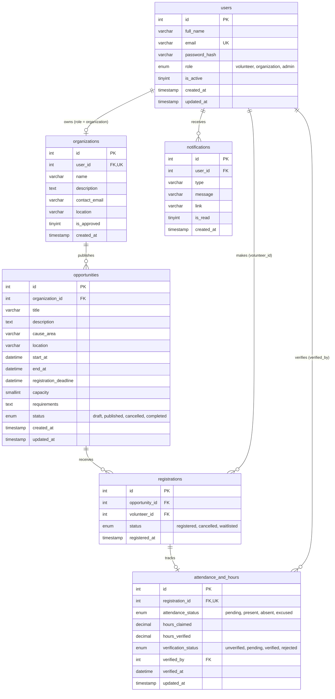
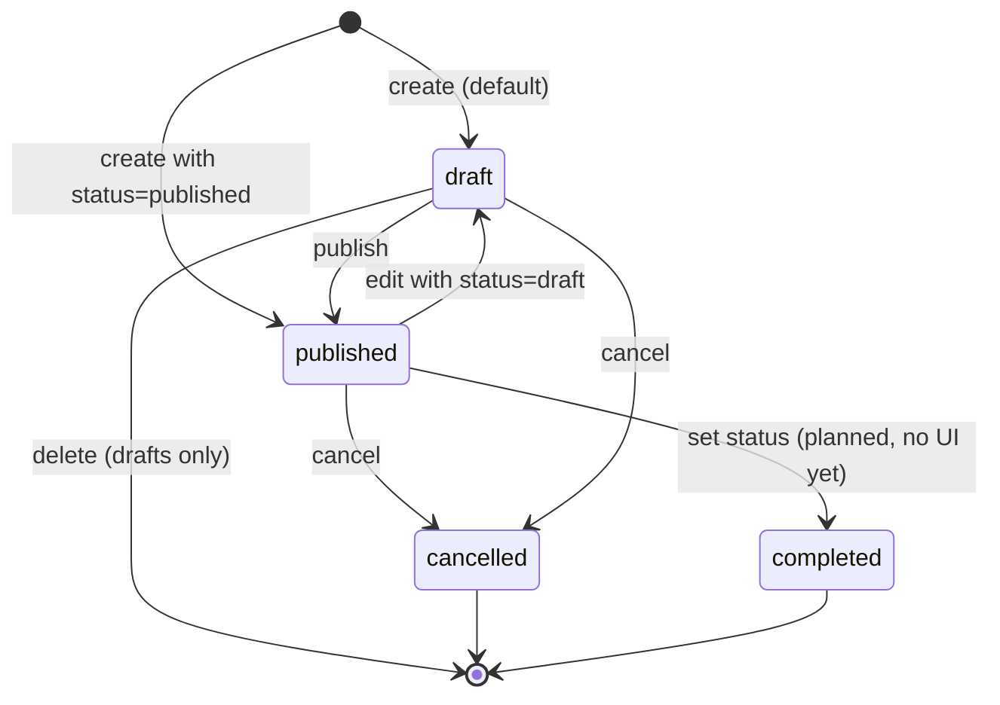
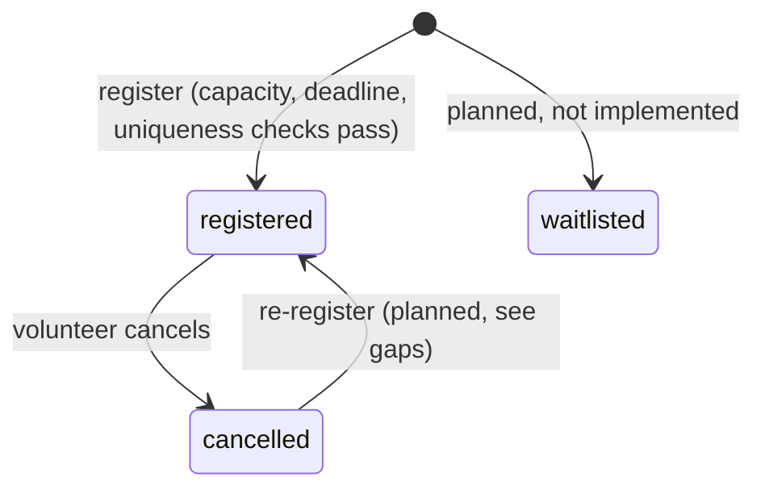
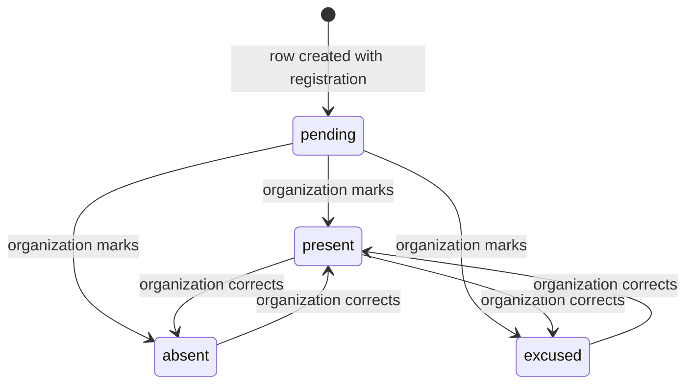
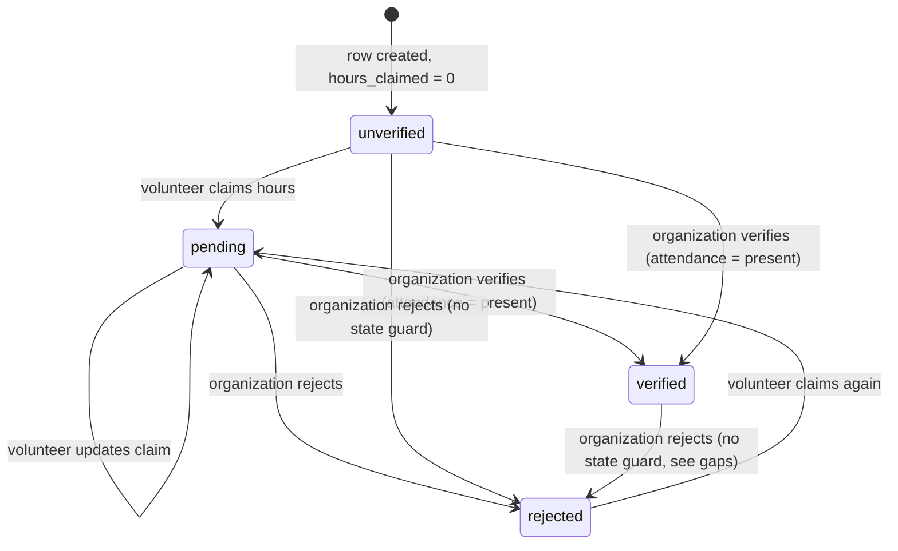

# HelpHive - Entity Relationship Diagram

Source of truth for the DDL is `database/schema.sql`. Column-level detail is in `DATABASE_SCHEMA.md`.

## 1. ERD with attributes

## 2. Relationship summary

| Parent | Child | Cardinality | FK | On delete |
|---|---|---|---|---|
| users | organizations | 1 to 0..1 | `organizations.user_id` (unique) | CASCADE |
| organizations | opportunities | 1 to N | `opportunities.organization_id` | CASCADE |
| opportunities | registrations | 1 to N | `registrations.opportunity_id` | CASCADE |
| users (volunteer) | registrations | 1 to N | `registrations.volunteer_id` | CASCADE |
| registrations | attendance_and_hours | 1 to 0..1 | `attendance_and_hours.registration_id` (unique) | CASCADE |
| users (verifier) | attendance_and_hours | 1 to N | `attendance_and_hours.verified_by` | SET NULL |
| users | notifications | 1 to N | `notifications.user_id` | CASCADE |

Notes:

- A user has one role at a time. When a volunteer registers an organization, `users.role` changes to `organization`.
- An `attendance_and_hours` row is created in the same transaction as its registration, so every registration has exactly one hours record from the start.
- `registrations` is the many-to-many join between volunteers and opportunities, made unique by `UNIQUE(opportunity_id, volunteer_id)`.
- There is no table for saved (bookmarked) opportunities. Bookmarks exist only in browser memory.

## 3. State machines

### 3.1 Opportunity status (`opportunities.status`)

Only `published` opportunities appear in search and accept registrations.

### 3.2 Registration status (`registrations.status`)

### 3.3 Attendance status (`attendance_and_hours.attendance_status`)

### 3.4 Hour verification status (`attendance_and_hours.verification_status`)

A `verified` row counts toward official totals. `HourModel::reject` has no guard on the current state, so a verified row can currently be moved to `rejected`; this is recorded in `docs/KNOWN_GAPS.md`.

Invariant (`chk_ah_verified`): `hours_verified` and `verified_at` are set if and only if `verification_status = 'verified'`. Official totals and reports read only `verified` rows.

## 4. Where each table is read and written

| Table | Written by | Read by |
|---|---|---|
| users | `AuthController` (register, role change), `AdminController` (toggle active) | `AuthController` (login), `AdminController` |
| organizations | `AuthController` (organization registration), `OrgProfileController`, `AdminController` (approve, reject) | `OrganizationModel` (ownership lookup), `OpportunityModel` (join for `org_name`), `AdminController` |
| opportunities | `OrgOpportunityController` | `OpportunityController` (search, detail), `RegistrationModel`, `HourModel` (joins) |
| registrations | `RegistrationController` | `VolunteerController`, `OpportunityModel::registrationsWithAttendance` |
| attendance_and_hours | `RegistrationModel::register` (insert), `HourModel` (claim, mark, verify, reject) | `HourModel` totals and reports, volunteer hours page, attendance page |
| notifications | `NotificationModel::notify` (no caller yet) | `NotificationController` |