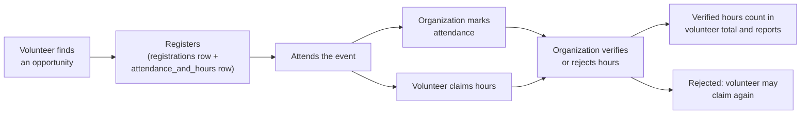
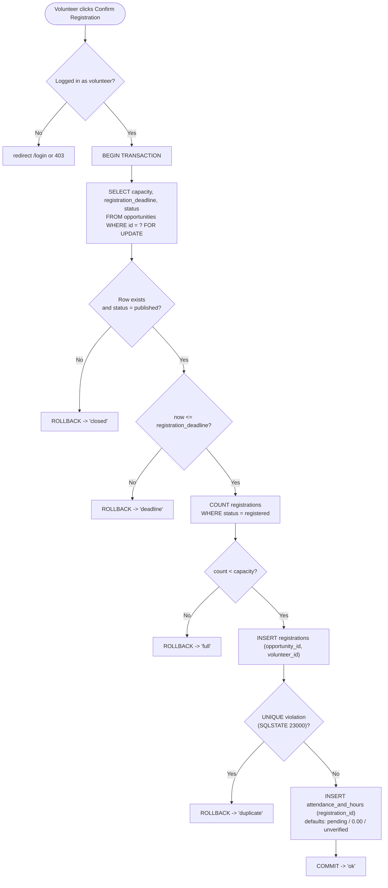
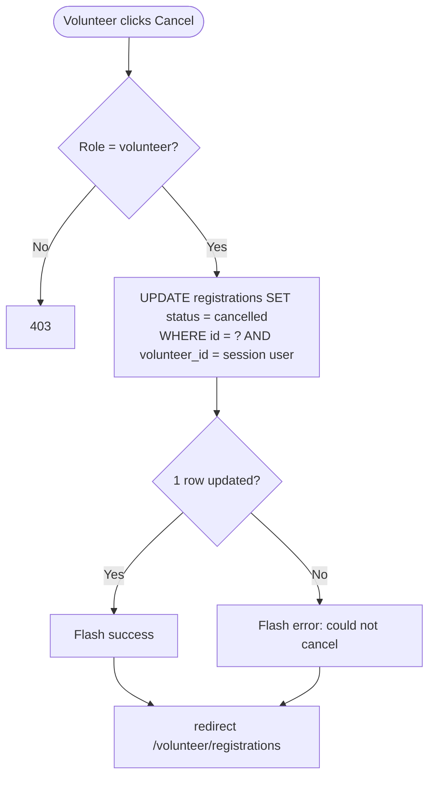
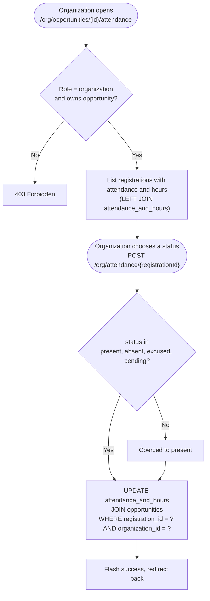
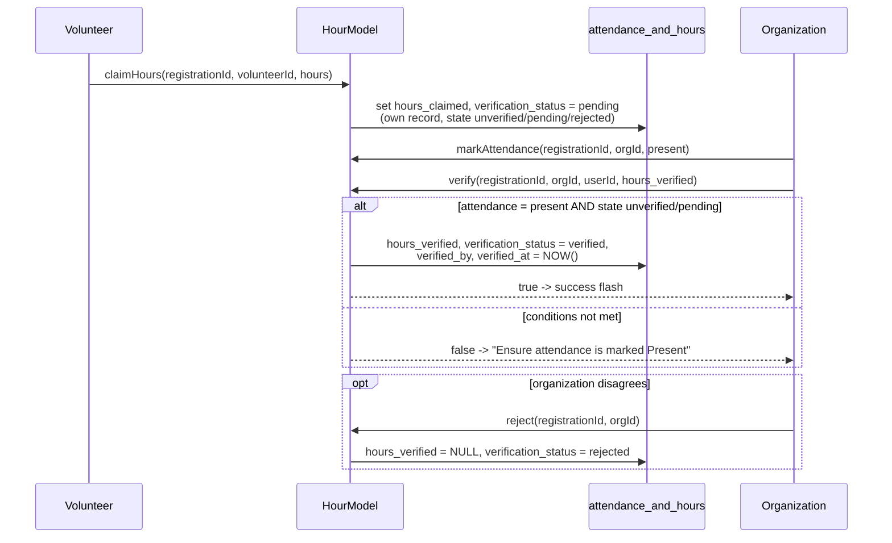
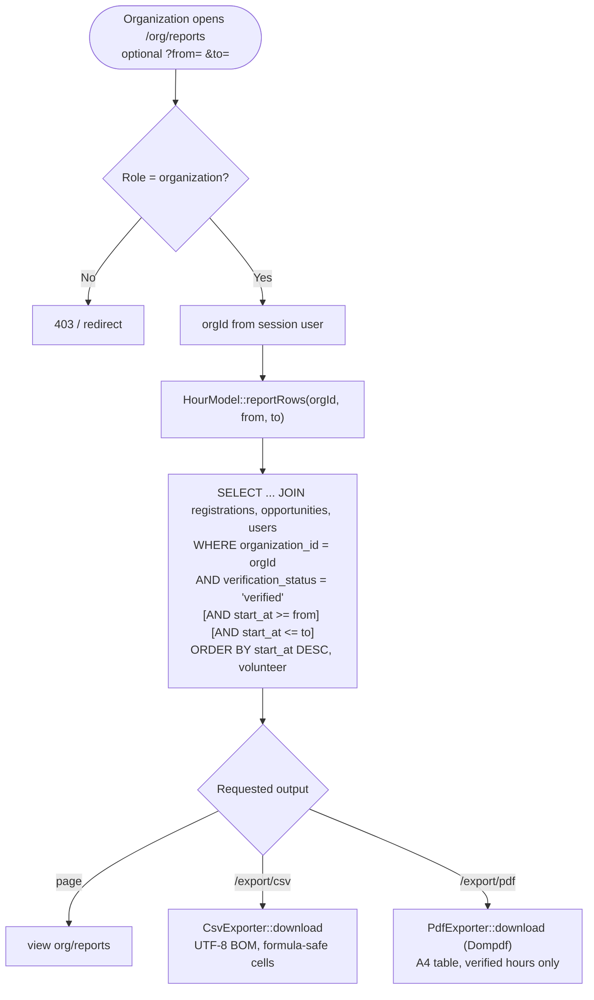
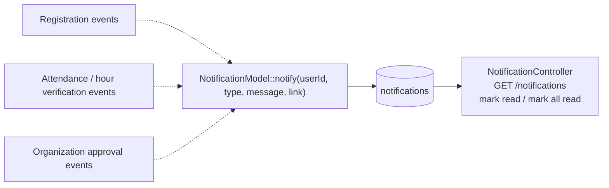

# HelpHive - Registration, Attendance, Hours, and Reports

Covers the volunteer journey from signing up for an opportunity to verified service hours and organization reports. Implemented in `RegistrationController`, `RegistrationModel`, `VolunteerController`, `AttendanceController`, `ReportController`, `HourModel`, and the exporters.

## 1. End-to-end journey

## 2. Registering for an opportunity (`POST /opportunities/{id}/register`)

`RegistrationModel::register` runs inside one transaction and locks the opportunity row, so two volunteers cannot take the last spot at the same time.

Controller reaction to each result:

| Result | Message | Destination |
|---|---|---|
| `ok` | Registration submitted successfully | Renders `opportunities/confirmed` |
| `duplicate` | You are already registered | `/volunteer/registrations` |
| `full` | Maximum capacity reached | `/opportunities/{id}` |
| `deadline` | Registration deadline has passed | `/opportunities/{id}` |
| `closed` (default) | No longer open for registrations | `/opportunities/{id}` |

Capacity counts only rows with `status = 'registered'`; cancelled rows free their spot.

## 3. Cancelling a registration (`POST /registrations/{id}/cancel`)

A cancelled registration keeps its row. Because of `UNIQUE(opportunity_id, volunteer_id)`, registering again for the same opportunity currently returns `duplicate` (see `docs/KNOWN_GAPS.md`).

## 4. Volunteer pages and the numbers they show

| Page | Route | Data |
|---|---|---|
| Dashboard | `/volunteer/dashboard` | Verified total, pending total, number of registrations |
| My Applications | `/volunteer/registrations` | All registrations with opportunity and organization details |
| Service Hours | `/volunteer/hours` | Verified total, pending total, history of `registered` records with attendance and verification state |
| Saved | `/volunteer/saved` | Placeholder; always empty list |

The two totals are separate queries:

| Total | Method | Sums | Filter |
|---|---|---|---|
| Verified | `HourModel::verifiedTotalForVolunteer` | `hours_verified` | `verification_status = 'verified'` |
| Pending | `HourModel::pendingTotalForVolunteer` | `hours_claimed` | `verification_status IN ('unverified','pending')` |

The pending total is for display only and must never be added to the verified total.

## 5. Attendance (organization)

## 6. Claiming, verifying, and rejecting hours

Rules:

| Action | Who | Preconditions | Result |
|---|---|---|---|
| Claim hours | Volunteer, own record | hours greater than 0 and at most 24; state `unverified`, `pending`, or `rejected` | `hours_claimed` set; state `pending` |
| Verify | Organization that owns the opportunity | attendance `present`; state `unverified` or `pending`; hours greater than 0 | `hours_verified`, `verified_by`, `verified_at` set; state `verified` |
| Reject | Organization that owns the opportunity | none enforced on state | `hours_verified` cleared; state `rejected` |

## 7. Reports and exports (organization)

Columns in every report: opportunity title, start date, volunteer name and email, attendance status, verified hours, verification time. Only `verified` rows appear; pending, unverified, and rejected hours are never included.

Organization dashboard totals use `HourModel::verifiedTotalForOrg` (verified only). The administrator dashboard total uses `HourModel::platformTotalVerified` (verified only).

## 8. Notifications

Dotted arrows mean planned: `notify()` exists but no controller calls it yet, so the notifications page has nothing to show until events are wired in. Suggested events and recipients are in `docs/KNOWN_GAPS.md`.