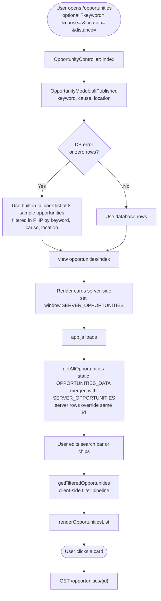
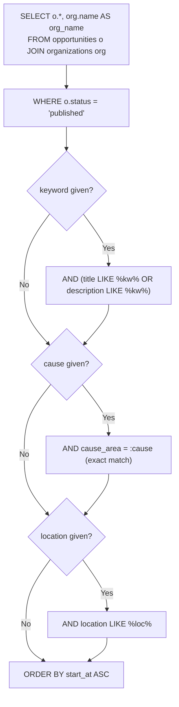
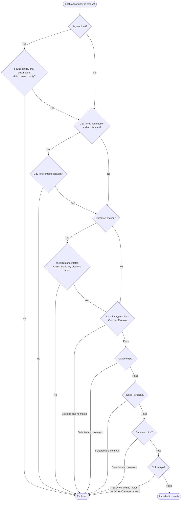
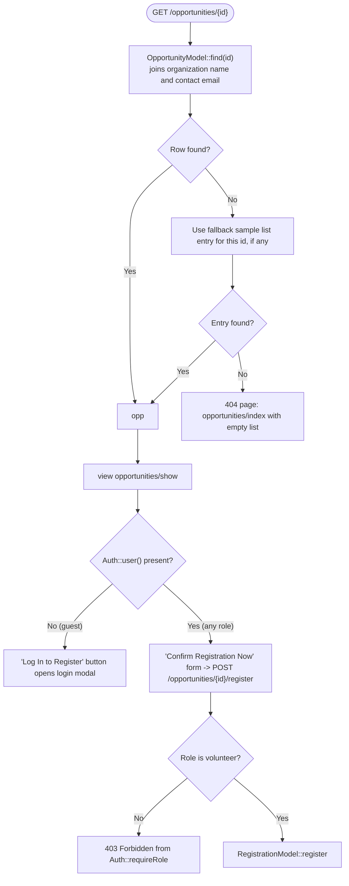

# HelpHive - Search and Filter Flow

Covers `GET /opportunities` (browse and search) and `GET /opportunities/{id}` (detail). Implemented across `app/controllers/OpportunityController.php`, `app/models/OpportunityModel.php`, `app/views/opportunities/index.php`, `app/views/opportunities/show.php`, and `public/assets/js/app.js`.

## 1. Summary

Search works in two stages:

1. Server stage: PHP and SQL return published opportunities, narrowed by `keyword`, `cause`, and `location` from the query string.
2. Client stage: `app.js` re-filters the list in the browser as the user changes the search bar and the filter chips. It adds filters that have no database columns yet (distance, location type, good for, duration, skills).

The two stages are not yet unified. The current gaps are listed in section 7.

## 2. End-to-end flow

## 3. Server-side query (`OpportunityModel::allPublished`)

| Parameter | Matching | Notes |
|---|---|---|
| `keyword` | `LIKE` on `title` and `description` | Does not search the organization name on the server (the client does) |
| `cause` | Exact match on `cause_area` | Values such as Environment, Education, Animal Welfare, Community Support |
| `location` | `LIKE` on `location` | Text only; no GPS or Maps API |
| `distance` | Read by the controller but not used in SQL | Handled by `app.js` only |
| Status | Always `published` | Draft, cancelled, and completed are excluded |

All values are bound parameters. `LIKE` wildcards (`%`, `_`) typed by the user are not escaped, so they act as wildcards.

The index `ft_opp_search` (FULLTEXT on title and description) exists but the query currently uses `LIKE`, so it is not used.

## 4. Client-side filter pipeline (`getFilteredOpportunities` in `app.js`)

An opportunity must pass every active filter. Filters with no selection are skipped.

Filter reference:

| Filter | UI control | Server column | Client field | Match rule |
|---|---|---|---|---|
| Keyword | Search bar | `title`, `description` | title, org, description, skills, cause, city | Case-insensitive substring |
| City / Province | Searchable dropdown (NCR, Luzon, Visayas, Mindanao cities), default "Any" | `location` | `city` | Case-insensitive substring |
| Distance | Dropdown: 5, 10, 15, 25, 50 km, province | none | `city` plus a static distance table | Proximity clusters between known cities |
| Location type | Chips: On-site, Remote | none | `type` (default "On-site") | Exact match on chip value |
| Cause area | Chips | `cause_area` | `cause` | Substring match |
| Good for | Chips | none | `goodFor` (default "Individuals & Groups") | Substring match |
| Duration | Chips | none | `duration` (default "One day") | Substring match |
| Skills | Chips | none | `skills` (default "General Volunteering") | Substring match; `none` passes |
| Reset All Filters | Button | n/a | n/a | Clears keyword, location, distance, and every chip group, then re-renders |

## 5. URL synchronization

When the user presses Search, `handleSearchSubmit`:

1. Closes open dropdowns.
2. Runs the filters and re-renders results.
3. Rewrites the address bar with `history.replaceState` to `/opportunities?keyword=...&location=...&distance=...` (only non-empty values; "Any" is omitted).
4. Scrolls smoothly to the results container.

Filter chips (cause, good for, duration, skills, location type) are not written to the URL. A shared link therefore restores only keyword, location, and distance (and the server applies `keyword`, `cause`, `location` on reload).

## 6. Detail view (`GET /opportunities/{id}`)

The button is shown to every logged-in user, but only volunteers pass the server-side role check. The view `opportunities/register.php` (the long volunteer registration form) is not rendered by any controller; its form posts to the same endpoint.

## 7. Known differences from the intended design

These are recorded with fixes in `docs/KNOWN_GAPS.md`.

| Topic | Current behavior | Intended behavior |
|---|---|---|
| Date filter | Not implemented on server or client | Requirement: filter by date |
| Detail access | `find()` does not filter on status, so draft or cancelled opportunities open by direct URL | Only published opportunities visible to non-owners |
| Empty database | Falls back to 8 built-in sample opportunities | Show an empty-state message |
| Static dataset | `OPPORTUNITIES_DATA` in `app.js` is merged into the client list, so sample items appear even when the database has rows | Client list built only from server data |
| Filters without columns | Distance, type, good for, duration, skills exist only in the client | Add columns or tables, or remove the controls |
| Pagination | Control is static; all results render on one page | Server-side pagination |
| Saved opportunities | Bookmark state lives in browser memory only; `/volunteer/saved` always receives an empty list | Persist in a `saved_opportunities` table |
| Past events | No filter on `start_at` or `registration_deadline` | Hide or mark closed events |