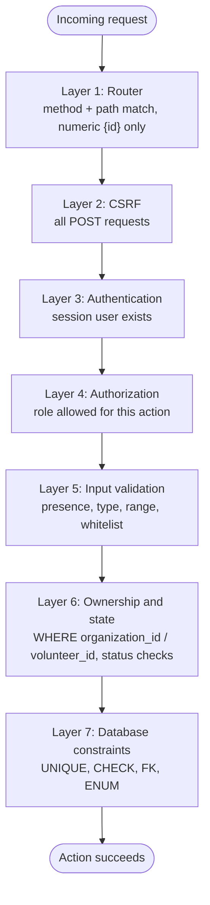
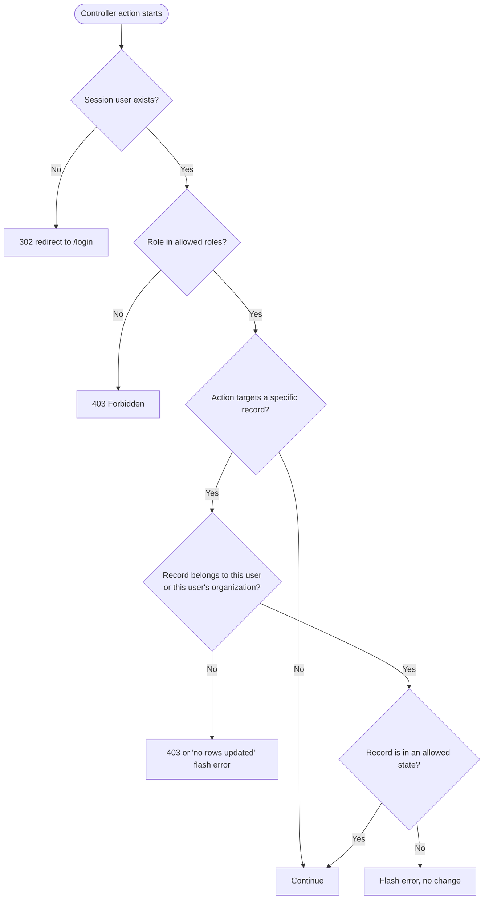
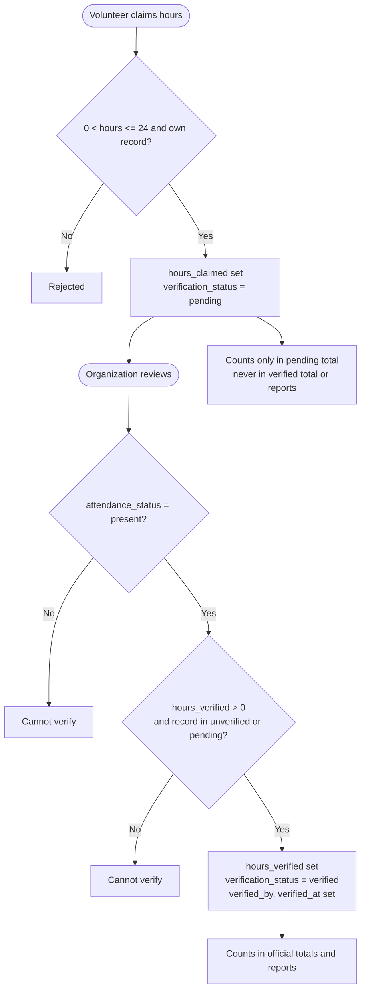

# HelpHive - Validation and Access Decision Flows

This document records how user input and user permissions are validated today, and the status codes returned. Items marked "gap" are tracked in `docs/KNOWN_GAPS.md`.

## 1. Layers of validation

A request stops at the first layer that fails. Layers 6 and 7 exist so that a bug in an earlier layer cannot corrupt data.

## 2. Access decision flow (every protected action)

How ownership is checked per area:

| Area | Ownership check |
|---|---|
| Opportunity edit and attendance pages | Controller loads the record and compares `organization_id` to the session user's organization id; 403 on mismatch |
| Opportunity publish, cancel, delete, update | `WHERE id = :id AND organization_id = :oid` in `OpportunityModel` |
| Mark attendance, verify, reject | `JOIN opportunities ... WHERE o.organization_id = :oid` in `HourModel` |
| Claim hours | `JOIN registrations ... WHERE r.volunteer_id = :vid` in `HourModel::claimHours` |
| Cancel registration | `WHERE id = :id AND volunteer_id = :vid` in `RegistrationModel::cancel` |
| Notifications | `markAsRead(id, userId)` scopes to the owning user |

## 3. Field validation matrix

| Endpoint | Field | Rule applied | Failure behavior |
|---|---|---|---|
| `POST /register` | email | non-empty, unique | Flash error; duplicate redirects to `/login` |
| | password | length >= 8 | Flash error, redirect `/register` |
| | first and last name | combined non-empty | Flash error, redirect `/register` |
| | role | whitelist `volunteer` or `organization`, else `volunteer` | Silent coercion |
| `POST /org/register` | organization_name, location, description | non-empty | Flash error, redirect `/register?role=organization` |
| | session user | must exist | Flash error, redirect `/login` |
| | one organization per user | `findByUserId` | Flash info, redirect `/org/dashboard` |
| `POST /login` | email, password | `findByEmail` then `password_verify` | Generic error message |
| | is_active | must be 1 | "Account deactivated" message |
| `POST /opportunities/{id}/register` | role | volunteer only | 403 |
| | opportunity status | must be `published` | `closed` result, flash error |
| | deadline | now must not be after `registration_deadline` | `deadline` result |
| | capacity | count of `registered` rows must be below `capacity` | `full` result |
| | duplicate | `UNIQUE(opportunity_id, volunteer_id)` | `duplicate` result |
| `POST /volunteer/hours/{id}/claim` | hours | greater than 0 and at most 24 | Flash error |
| | record | must belong to the volunteer, state `unverified`, `pending`, or `rejected` | "Could not claim hours" |
| `POST /org/attendance/{id}` | attendance_status | whitelist `present`, `absent`, `excused`, `pending`; invalid value becomes `present` | Silent coercion |
| `POST /org/hours/{id}/verify` | hours_verified | greater than 0 | Flash error |
| | state | attendance must be `present`; state `unverified` or `pending` | "Could not verify hours" |
| `POST /org/hours/{id}/reject` | record | must belong to the organization | "Could not reject hours" |
| `POST /org/opportunities/create` and `/edit` | all fields | `trim` only; defaults applied for missing values | Database CHECK or ENUM errors surface as exceptions (gap) |
| `GET /opportunities` | keyword, cause, location | passed as bound parameters; `distance` accepted but not used by SQL | No error |
| `GET /org/reports*` | from, to | passed as bound parameters; format not validated | Empty or unexpected results |
| `POST /admin/*` | id | numeric from router; admin role | No row updated if id unknown |

## 4. HTTP status and outcome map

| Situation | Response |
|---|---|
| No route matches | 404 "Not found" |
| POST without a valid CSRF token | 419 "Invalid CSRF token." |
| Guest on a protected route | 302 to `/login` |
| Authenticated user with the wrong role | 403 "Forbidden" |
| Organization opens another organization's opportunity | 403 "Forbidden: you do not own this opportunity." |
| Validation failure on a form | 302 back to the form with a Flash error |
| Successful POST | 302 (post-redirect-get) with a Flash success or info message |
| Registration success | 200 renders `opportunities/confirmed` |
| Unhandled PDO exception | PHP error (no friendly page yet) |

## 5. Hour-integrity validation (the critical rule)

Three independent barriers keep unverified hours out of official numbers:

1. Query barrier: every total and report query contains `verification_status = 'verified'`.
2. Column barrier: `hours_claimed` (volunteer input) and `hours_verified` (organization-confirmed) are separate columns; totals sum `hours_verified` only.
3. Database barrier: `chk_ah_verified` rejects any row whose `hours_verified` is set while `verification_status` is not `verified`.

## 6. Output and transport protections

| Concern | Protection |
|---|---|
| SQL injection | PDO prepared statements with bound parameters everywhere |
| XSS | `e()` on dynamic output; `json_encode` for data passed to JavaScript |
| CSRF | Token in session, `hash_equals` comparison, hidden field in every POST form |
| Session fixation | `session_regenerate_id(true)` on login |
| Spreadsheet formula injection | Cells starting with `=`, `+`, `-`, `@` are prefixed with an apostrophe in CSV export |
| Enumeration of accounts | Single generic login error |