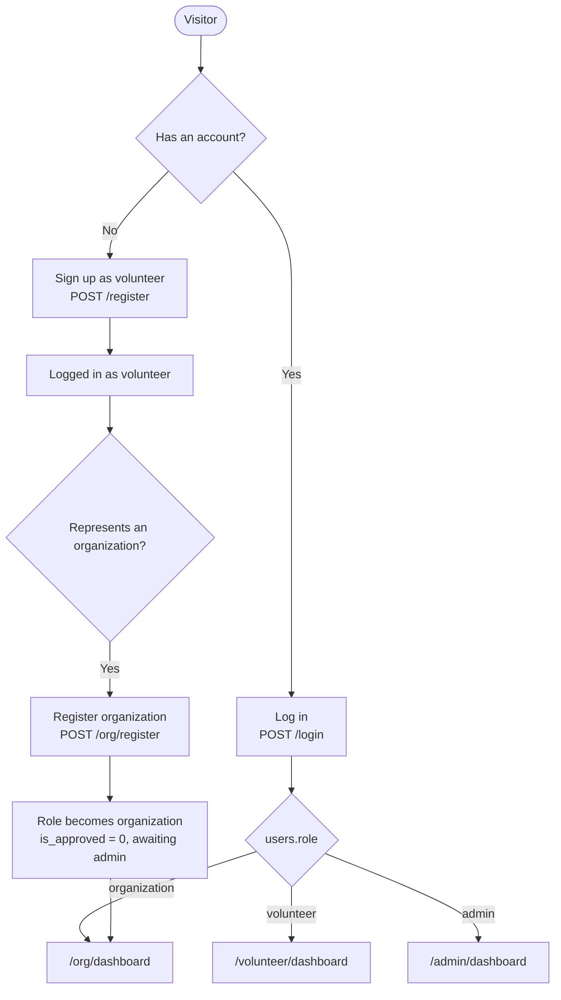
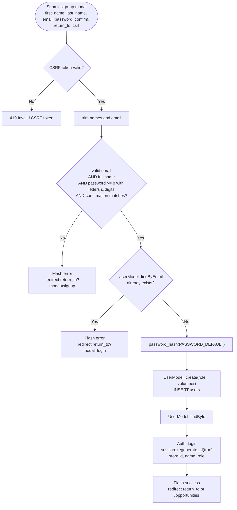
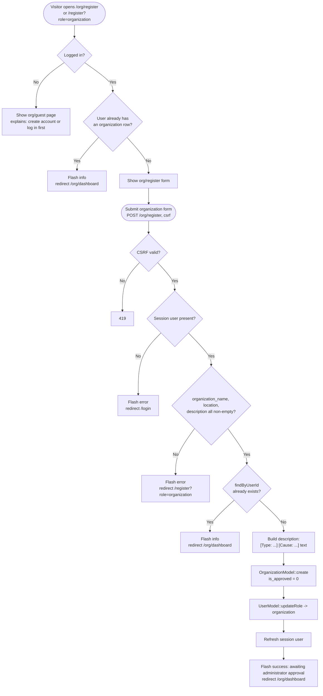
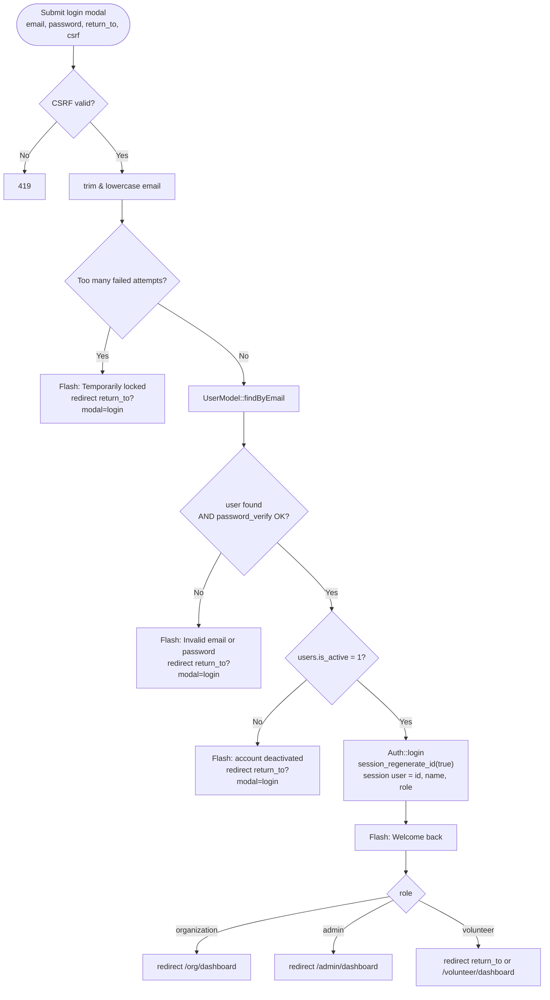
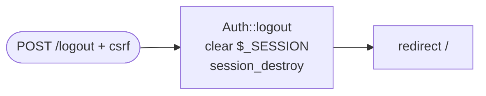
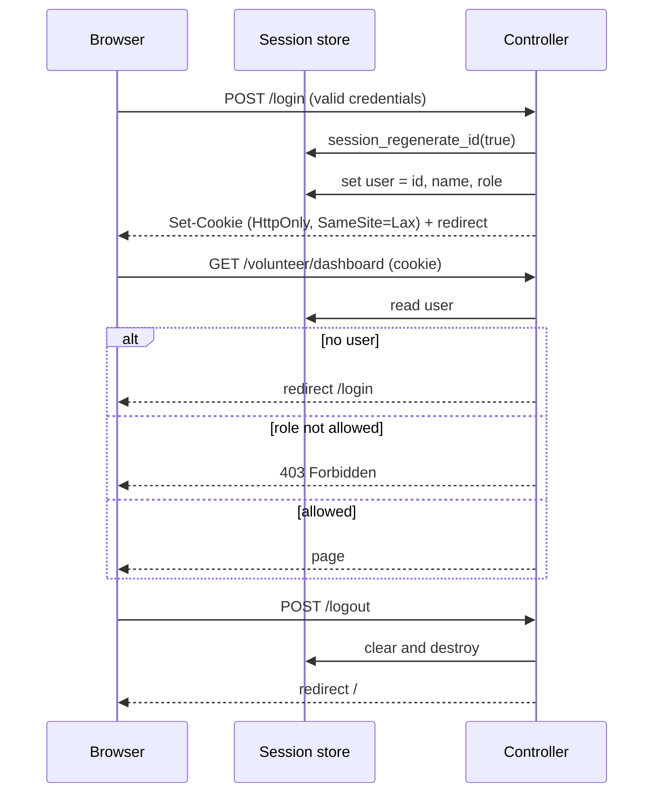

# HelpHive - Authentication Flows

Covers volunteer registration, organization registration, login, logout, and session handling. Implemented in `app/controllers/AuthController.php`, `app/utils/Auth.php`, `app/models/UserModel.php`, and `app/models/OrganizationModel.php`.

## 1. Overview: who can do what

There is no public administrator registration. Administrator accounts are created in the database (seed data or manual insert).

## 2. Volunteer registration (`POST /register`)

Volunteer registration is modal-based (`#signup-modal`). Standalone auth pages are removed. The "I want to join as" selector sends `role`. Any value other than `volunteer` or `organization` is coerced to `volunteer`. The volunteer path runs when `role = volunteer`.

Rules applied:

| Field | Rule |
|---|---|
| `first_name` + `last_name` | Joined and trimmed; must not be empty |
| `email` | Trimmed, lowercased, and validated with `filter_var(..., FILTER_VALIDATE_EMAIL)`; must be unique (checked in code and by the `UNIQUE` index) |
| `password` | Minimum 8 characters containing both letters and numbers; must match `password_confirmation`; stored only as a bcrypt hash |
| `role` | Forced to `volunteer` for this path; the client cannot create an admin |

## 3. Organization registration (`POST /org/register`)

Organization registration is a second step for an account that already exists. It requires a logged-in user.

Effects to be aware of:

- The user's role changes from `volunteer` to `organization` immediately, before approval. From that moment the user can open `/org/*` pages and can no longer use volunteer-only actions, because `requireRole(volunteer)` rejects them.
- `organization_type` and `cause_area` are not separate columns; they are prepended to `organizations.description` as `[Type: ...]` and `[Cause: ...]`.
- Approval state lives in `organizations.is_approved` (0 until an administrator approves).

## 4. Login (`POST /login`)

Login is modal-based (`#login-modal`).

Design notes:

- A single generic message is shown for an unknown email and for a wrong password, so the form does not reveal which emails exist.
- The active check runs after the password check, so a deactivated user sees the deactivation message only with the correct password.
- `GET /login` redirects to `/` when a session already exists.

## 5. Logout (`POST /logout`)

Logout is a POST so that a link on another site cannot log a user out.

## 6. Session lifecycle and access checks

| Helper | Behavior |
|---|---|
| `Auth::boot()` | Sets cookie params (HttpOnly, SameSite=Lax), starts the session, and re-verifies session user against DB; called once in `public/index.php` |
| `Auth::checkSessionUser()` | Re-reads user row from database; immediately logs out deactivated users (`is_active = 0`) and synchronizes role and name updates (G-23) |
| `Auth::login($user)` | Regenerates the session id and stores `id`, `name`, `role` |
| `Auth::user()` / `Auth::id()` | Read the session user |
| `Auth::requireLogin()` | Re-verifies user and redirects guests or deactivated users to `/login` |
| `Auth::requireRole(...$roles)` | Calls `requireLogin`, then returns 403 if the role is not in the list |
| `Auth::logout()` | Clears and destroys the session |

## 7. Role and landing summary

| Role | Can register via | Lands on after login | Typical area |
|---|---|---|---|
| Volunteer | Sign Up modal | `/volunteer/dashboard` (or return page) | `/volunteer/*`, `/opportunities`, `/notifications` |
| Organization | `/org/register` after logging in | `/org/dashboard` | `/org/*`, `/notifications` |
| Admin | database only | `/admin/dashboard` | `/admin/*`, `/notifications` |