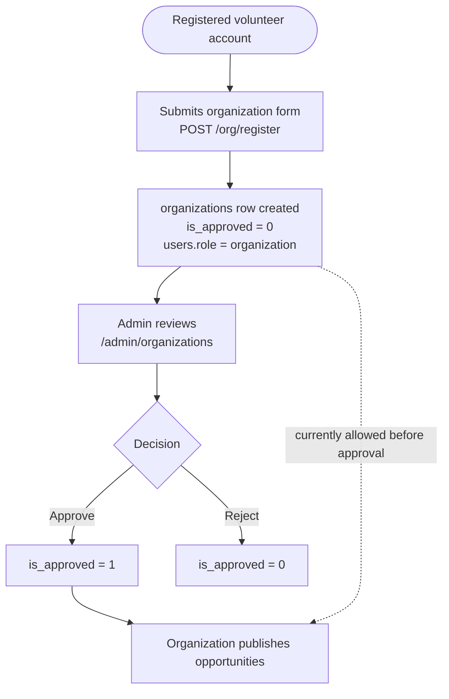
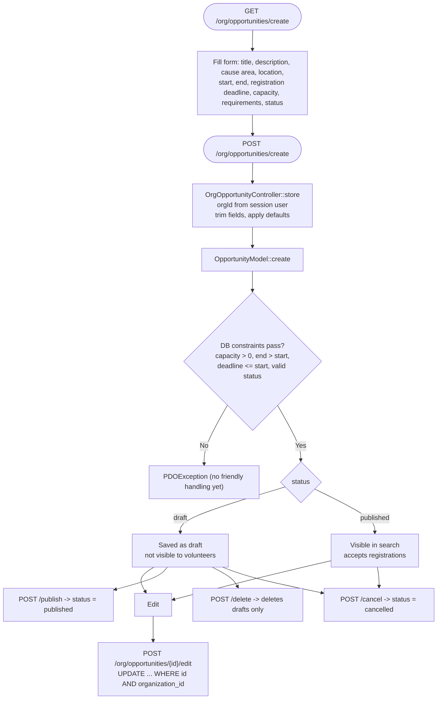
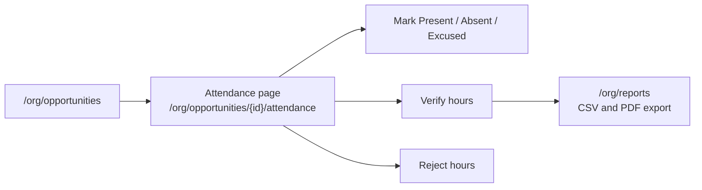
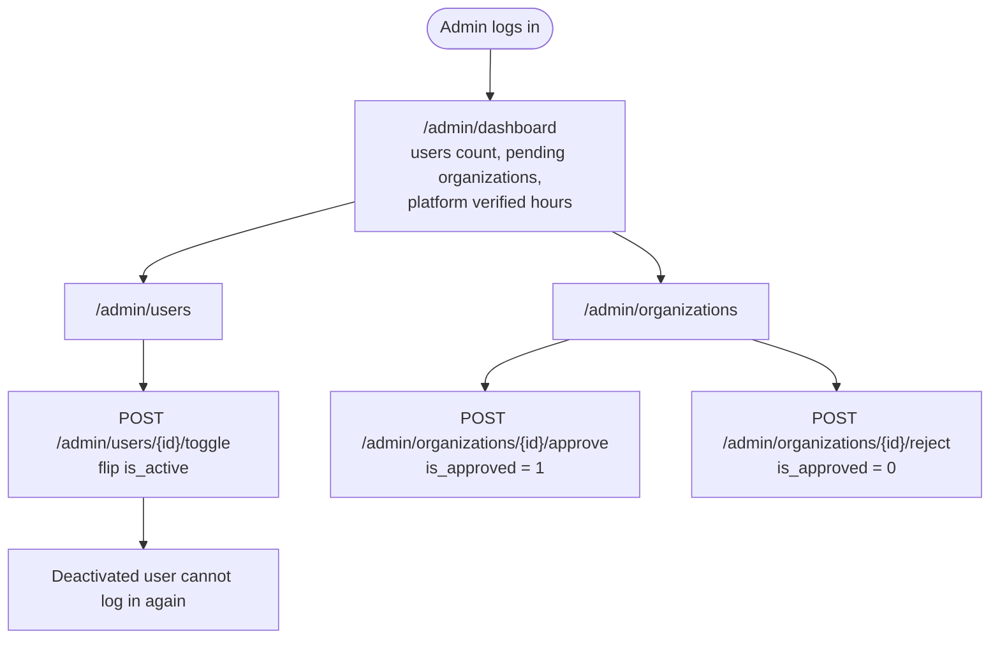

# HelpHive - Organization and Administrator Flows

Covers the organization lifecycle (onboarding, approval, publishing opportunities) and administrator actions. Implemented in `AuthController`, `OrgDashboardController`, `OrgProfileController`, `OrgOpportunityController`, `AdminController`, `OpportunityModel`, `OrganizationModel`, and `UserModel`.

## 1. Organization lifecycle

The dotted edge is the current behavior: `OrgOpportunityController` does not check `is_approved`, so an organization can create and publish opportunities before an administrator approves it. The intended rule is that only approved organizations can publish (see `docs/KNOWN_GAPS.md`).

## 2. Organization dashboard and profile

| Route | Action | Behavior |
|---|---|---|
| `GET /org/dashboard` | `OrgDashboardController@index` | Organization record, opportunity count, verified hours total (`verifiedTotalForOrg`) |
| `GET /org/profile` | `OrgProfileController@edit` | Shows the organization form (reuses `org/register` view) |
| `POST /org/profile` | `OrgProfileController@update` | Updates name, description, contact email, location of the organization owned by the session user |

The dashboard "volunteers" figure is currently derived as opportunity count times 8, not counted from registrations (see gaps).

## 3. Opportunity lifecycle

Route and method map:

| Route | Method | Model call | Ownership |
|---|---|---|---|
| `GET /org/opportunities` | `index` | `forOrganization(orgId)` | Own opportunities only |
| `GET /org/opportunities/create` | `create` | none | organization role |
| `POST /org/opportunities/create` | `store` | `create($data)` | `organization_id` from session |
| `GET /org/opportunities/{id}/edit` | `edit` | `find($id)` then compare `organization_id` | 403 if not owner |
| `POST /org/opportunities/{id}/edit` | `update` | `update($id, $orgId, $data)` | `WHERE id AND organization_id` |
| `POST /org/opportunities/{id}/publish` | `publish` | `setStatus($id, $orgId, 'published')` | `WHERE id AND organization_id` |
| `POST /org/opportunities/{id}/cancel` | `cancel` | `setStatus($id, $orgId, 'cancelled')` | `WHERE id AND organization_id` |
| `POST /org/opportunities/{id}/delete` | `delete` | `deleteDraft($id, $orgId)` | `WHERE ... AND status = 'draft'` |

Cancelling does not currently notify registered volunteers or cancel their registrations (see gaps).

## 4. Attendance and verification from the organization side

See `docs/FLOW_REGISTRATION_AND_HOURS.md` sections 5 to 7. In short:

## 5. Administrator actions

| Action | Effect | Notes |
|---|---|---|
| Toggle user | `users.is_active = NOT is_active` | Blocks future logins; open sessions are immediately terminated via `Auth::checkSessionUser` (G-23). Administrator self-deactivation is strictly blocked (G-24) |
| Approve organization | `organizations.is_approved = 1` | Sets user role to `organization` and sends in-app notification |
| Reject organization | `organizations.is_approved = 0` | Reverts user role to `volunteer` (G-24) and sends in-app notification |

Seeded accounts (`database/seed.sql`): one administrator, three organization accounts (Blue Shores Initiative, Green Shift Media, Paws & Care Foundation), and two volunteers. All seeded users share one password hash; use the seed file or generate a new hash with `password_hash()` for local testing.

## 6. Who sees what

| Page group | Guest | Volunteer | Organization | Admin |
|---|---|---|---|---|
| Home, search, detail | yes | yes | yes | yes |
| Register for opportunity | no (login prompt) | yes | no (403) | no (403) |
| `/volunteer/*` | no | yes | no | no |
| `/org/*` (except `/org/register` flow) | no | no | yes | no |
| `/admin/*` | no | no | no | yes |
| `/notifications` | no | yes | yes | yes |